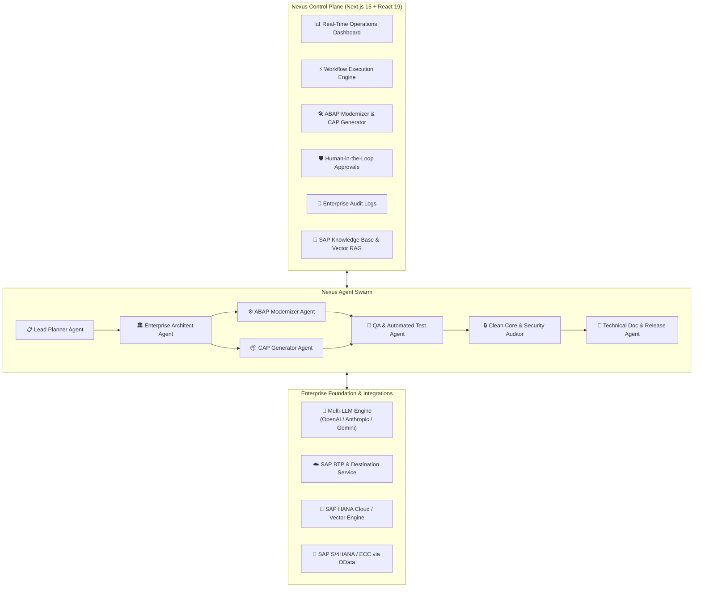

<div align="center">

# ⚡ Nexus Agent

### **Next-Generation Autonomous Multi-Agent Orchestration & Modernization Platform for SAP Ecosystems**

[](LICENSE)
[](https://nextjs.org/)
[](https://react.dev/)
[](https://www.typescriptlang.org/)
[](https://tailwindcss.com/)
[](CONTRIBUTING.md)
[](#contributing)

<p align="center">
  <a href="#key-features">Key Features</a> •
  <a href="#agent-swarm-architecture">Architecture</a> •
  <a href="#quick-start">Quick Start</a> •
  <a href="#project-structure">Project Structure</a> •
  <a href="#configuration">Configuration</a> •
  <a href="#contributing">Contributing</a> •
  <a href="#roadmap">Roadmap</a>
</p>

</div>

---

## 🌟 Overview

**Nexus Agent** is an enterprise-grade, open-source multi-agent AI orchestration platform designed to accelerate, modernize, and govern enterprise applications across **SAP S/4HANA**, **SAP ECC 6.0**, **SAP BTP (Business Technology Platform)**, and hybrid cloud ecosystems.

By coordinating a swarm of specialized domain agents, Nexus Agent automates complex enterprise workflows: from refactoring legacy ABAP code to modern **Clean Core RAP** (RESTful Application Programming) and **SAP CAP** (Cloud Application Programming) services, orchestrating OData integrations, and enforcing strict human-in-the-loop governance and compliance auditing.

---

## 🚀 Key Features

<table>
  <tr>
    <td width="50%">
      <h3>🤖 Autonomous Multi-Agent Swarm</h3>
      <p>Coordinated, role-specialized AI agents collaborate to plan, architect, refactor, generate, test, audit, and deploy enterprise solutions with full telemetry and trace visibility.</p>
    </td>
    <td width="50%">
      <h3>🔄 Legacy ABAP to Clean Core Modernizer</h3>
      <p>Transform monolithic custom code, direct database manipulations, and classic Dynpro/Reports into modern ABAP Cloud, Core Data Services (CDS), and BTP side-by-side extensions.</p>
    </td>
  </tr>
  <tr>
    <td width="50%">
      <h3>⚡ SAP CAP Full-Stack Generator</h3>
      <p>Generate production-grade SAP Cloud Application Programming model services, CDS data models, OData V4 endpoints, event handlers, and SAP Fiori Elements metadata.</p>
    </td>
    <td width="50%">
      <h3>🔗 OData & BTP Service Orchestrator</h3>
      <p>Test, mock, validate, and introspect SAP S/4HANA OData V2/V4 services, SAP Graph APIs, and BTP destination configurations directly within interactive sandboxes.</p>
    </td>
  </tr>
  <tr>
    <td width="50%">
      <h3>🛡️ Human-in-the-Loop (HITL) Governance</h3>
      <p>Enforce strict enterprise guardrails with automated risk scoring for Transport Requests, mass data operations, Clean Core overrides, and production releases.</p>
    </td>
    <td width="50%">
      <h3>📜 Immutable Audit Logging & Telemetry</h3>
      <p>Full audit trail capturing agent decision paths, token consumptions, latency metrics, SAP CTS transport references, and user approval histories.</p>
    </td>
  </tr>
</table>

---

## 🏗️ Agent Swarm Architecture



---

## 🤖 Built-in Specialized Agents

| Agent | Role | Category | Primary Focus |
| :--- | :--- | :--- | :--- |
| **Lead Planner** | Orchestration & Decomposition | `Strategy` | Decomposes business requirements into dependency-managed agent tasks. |
| **Enterprise Architect** | Solution & Clean Core Design | `Strategy` | Validates target architecture against SAP Clean Core principles and BTP best practices. |
| **ABAP Modernizer** | Code Modernization & Migration | `Engineering` | Refactors classic ABAP into ABAP Cloud, CDS Views, and RAP Business Objects. |
| **CAP Generator** | Cloud App Development | `Engineering` | Generates Node.js/Java CAP services, CDS schemas, and Fiori UI definitions. |
| **QA Engineer** | Quality & Verification | `Governance` | Generates unit tests, mocks, CDS test suites, and integration tests. |
| **Security & Compliance** | Clean Core & Risk Gatekeeper | `Governance` | Checks authorization objects, SQL safety, and enforces approval triggers. |
| **Release & Docs** | Technical Documentation & Transport | `Operations` | Produces changelogs, SAP Transport Request summaries, and release manifests. |

---

## ⚡ Quick Start

### Prerequisites

Ensure you have the following installed on your development machine:

- **Node.js**: `v18.18.0` or later (Node.js `v20+` or `v22+` recommended)
- **npm**, **pnpm**, or **yarn**
- **Git**

### 1. Clone the Repository

```bash
git clone https://github.com/Priyadharshan2003/nexus-agent.git
cd nexus-agent
```

### 2. Install Dependencies

```bash
npm install
# or
pnpm install
# or
yarn install
```

### 3. Configure Environment Variables

Copy the sample environment file to `.env.local`:

```bash
cp .env.example .env.local
```

Open `.env.local` and configure your API keys (Bring Your Own Key):

```ini
# AI / Foundation Model Providers (At least one required for live AI features)
OPENAI_API_KEY="your-openai-api-key"
ANTHROPIC_API_KEY="your-anthropic-api-key"
GEMINI_API_KEY="your-gemini-api-key"

# Optional: SAP BTP & S/4HANA Connectivity
SAP_BTP_SUBDOMAIN="your-subdomain"
SAP_BTP_DESTINATION_URL="https://destination-service..."
SAP_BTP_CLIENT_ID="your-client-id"
SAP_BTP_CLIENT_SECRET="your-client-secret"
SAP_BTP_AUTH_URL="https://subaccount.authentication..."

# Optional: SAP HANA Vector Engine
SAP_HANA_HOST="your-hana-host"
SAP_HANA_PORT="443"
SAP_HANA_USER="DBADMIN"
SAP_HANA_PASSWORD="your-secure-password"
```

> **Note:** Nexus Agent includes built-in mock telemetry and sample enterprise simulations, allowing you to run and explore the full UI without mandatory cloud credentials out-of-the-box!

### 4. Run the Development Server

```bash
npm run dev
```

Open [http://localhost:3000](http://localhost:3000) in your browser to access the Nexus Agent control plane.

### 5. Build for Production

```bash
npm run build
npm run start
```

---

## 📁 Project Structure

```
nexus-agent/
├── src/
│   ├── app/                      # Next.js 15 App Router pages & API routes
│   │   ├── abap-modernizer/      # ABAP to Clean Core modernizer interface
│   │   ├── agents/               # Multi-agent roster, metrics & configuration
│   │   ├── approvals/            # Human-in-the-Loop risk review & approval center
│   │   ├── audit-logs/           # Enterprise compliance & execution audit trail
│   │   ├── cap-generator/        # SAP Cloud Application Programming generator
│   │   ├── dashboard/            # Executive & operational metrics dashboard
│   │   ├── knowledge/            # Vector RAG & SAP enterprise documentation
│   │   ├── odata/                # OData explorer & BTP service simulator
│   │   ├── settings/             # System config, LLM providers & integrations
│   │   ├── workflows/            # Visual workflow designer & node execution trace
│   │   ├── api/                  # Backend REST API routes & agent executors
│   │   ├── globals.css           # Modern design tokens & global CSS styles
│   │   └── layout.tsx            # Global layout with responsive sidebar navigation
│   ├── components/               # Reusable React 19 UI components
│   │   ├── dashboard/            # KPI widgets, activity streams & charts
│   │   └── layout/               # Sidebar, header, navigation & command palettes
│   └── lib/                      # Core business logic & agent infrastructure
│       ├── agents/               # Agent prompt templates, logic & runners
│       ├── rag/                  # Vector embeddings & document retrieval
│       ├── sap/                  # SAP OData clients & BTP connectors
│       ├── store/                # State management & reactive telemetry
│       └── types.ts              # Strict TypeScript definitions & domain models
├── public/                       # Static assets & icons
├── .env.example                  # Template for environment variables
├── next.config.ts                # Next.js configuration
├── tailwind.config.ts            # Tailwind CSS theme & token config
├── tsconfig.json                 # TypeScript compiler configuration
├── CONTRIBUTING.md               # Community contribution guidelines
├── LICENSE                       # Apache 2.0 Open Source License
└── package.json                  # Project manifest and scripts
```

---

## ⚙️ Configuration Reference

| Variable | Description | Required | Default |
| :--- | :--- | :--- | :--- |
| `OPENAI_API_KEY` | API Key for OpenAI GPT-4o and embedding models | Optional | - |
| `ANTHROPIC_API_KEY` | API Key for Claude 3.5/3.7 Sonnet reasoning | Optional | - |
| `GEMINI_API_KEY` | API Key for Google Gemini 1.5/2.0 Flash & Pro | Optional | - |
| `SAP_BTP_SUBDOMAIN` | Subaccount subdomain for SAP BTP services | Optional | - |
| `SAP_BTP_DESTINATION_URL` | SAP BTP Destination Service endpoint | Optional | - |
| `SAP_BTP_CLIENT_ID` | OAuth2 Client ID for BTP service bindings | Optional | - |
| `SAP_BTP_CLIENT_SECRET` | OAuth2 Client Secret for BTP service bindings | Optional | - |
| `SAP_HANA_HOST` | Hostname for SAP HANA Cloud Vector DB | Optional | - |

---

## 🤝 Contributing to Nexus Agent

We believe in the power of open-source collaboration! Whether you are an SAP specialist, AI engineer, frontend developer, or technical writer, **your contributions are welcome and deeply valued**.

### Ways to Contribute

- 💡 **Suggest a Feature**: Have an idea for a new agent role, SAP BTP integration, or code refactor pattern? [Open a Feature Request](https://github.com/Priyadharshan2003/nexus-agent/issues).
- 🐛 **Report a Bug**: Encountered an issue? [Submit a Bug Report](https://github.com/Priyadharshan2003/nexus-agent/issues).
- 🧑‍💻 **Submit a PR**: Check out our open issues tagged with [`good first issue`](https://github.com/Priyadharshan2003/nexus-agent/labels/good%20first%20issue).
- 📖 **Improve Documentation**: Enhance developer guides, ABAP refactoring examples, or agent prompt techniques.

### Contribution Workflow

1. **Fork the Repository**: Click the `Fork` button at the top of the repository.
2. **Create a Feature Branch**:
   ```bash
   git checkout -b feature/awesome-new-agent
   ```
3. **Make Your Changes**: Ensure your code follows our TypeScript and styling conventions.
4. **Run Verification & Linting**:
   ```bash
   npm run lint
   npm run build
   ```
5. **Commit Your Changes**:
   ```bash
   git commit -m "feat(agents): add specialized CDS test generator agent"
   ```
6. **Push to Your Fork**:
   ```bash
   git push origin feature/awesome-new-agent
   ```
7. **Open a Pull Request**: Submit a PR to the `main` branch with a clear description of your changes.

For full details on our code standards and review process, please read our [Contributing Guide](CONTRIBUTING.md).

---

## 🗺️ Roadmap

- [x] **Core Multi-Agent Swarm Orchestrator**
- [x] **ABAP Monolith to Clean Core Modernizer UI**
- [x] **SAP CAP CDS & Service Generator**
- [x] **Human-in-the-Loop (HITL) Governance & Approvals**
- [x] **Enterprise Compliance & Audit Trails**
- [ ] **Live SAP BTP Destination Service Integration**
- [ ] **Real-Time WebSocket Agent Streaming & Interactive Canvas**
- [ ] **SAP ABAP SDK & RFC Connector Integration**
- [ ] **Automated GitHub Actions CI/CD pipeline for SAP CTS Transport generation**
- [ ] **Local LLM support via Ollama & vLLM**

---

## 🛡️ Security & Clean Core Compliance

Nexus Agent is architected with enterprise security as a first-class citizen:

- **Zero Hardcoded Secrets**: All API keys and connection strings use environment variables.
- **Air-Gapped / Private Cloud Ready**: Configurable to connect to self-hosted or private cloud LLM instances.
- **Role-Based HITL Gates**: Prevents autonomous agents from modifying production tables or releasing transports without human sign-off.
- **Data Privacy**: No enterprise proprietary data is persisted or shared outside your configured infrastructure.

To report security vulnerabilities, please refer to our [Security Policy](CONTRIBUTING.md#security).

---

## 📄 License

Nexus Agent is open-source software licensed under the **[Apache License 2.0](LICENSE)**.

---

<div align="center">

**Built with ❤️ for the Global SAP & Open Source AI Community.**

⭐ *If you find Nexus Agent useful, please give us a star on GitHub!* ⭐

</div>
